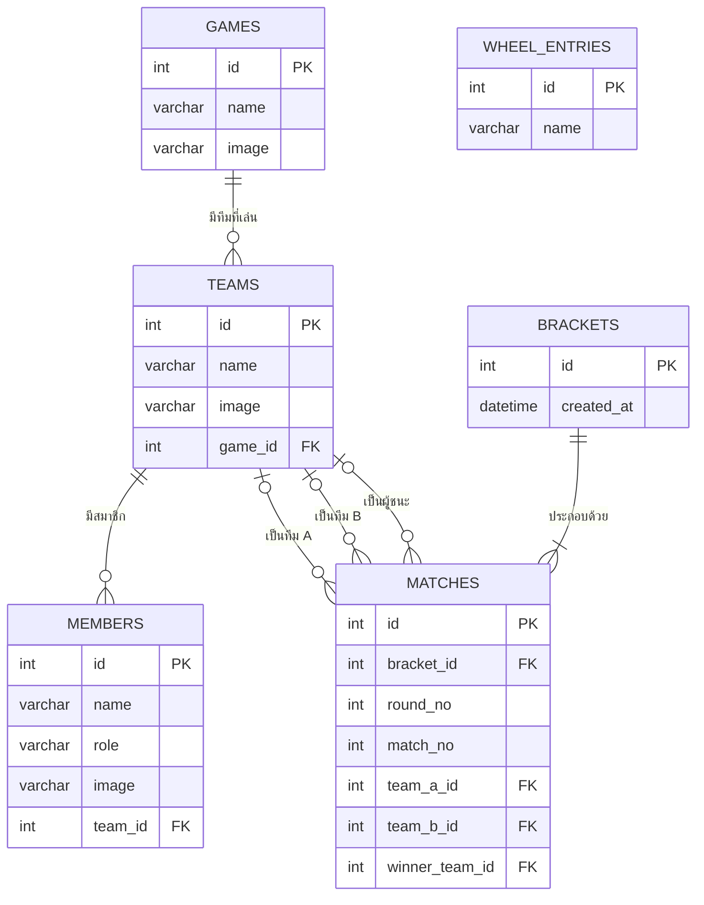

# แผนภาพ ER (Entity Relationship Diagram)

แผนภาพนี้เป็นแบบฐานข้อมูลเชิงสัมพันธ์สำหรับระบบ (ดูรายละเอียดตารางและ SQL ใน [database.md](database.md)) GitHub แสดงแผนภาพด้านล่างให้อัตโนมัติ

## คำอธิบายความสัมพันธ์

| ความสัมพันธ์ | ชนิด | คำอธิบาย |
|---|---|---|
| GAMES กับ TEAMS | 1 ต่อ หลาย | เกมหนึ่งเกมมีได้หลายทีม แต่หนึ่งทีมเล่นหนึ่งเกม |
| TEAMS กับ MEMBERS | 1 ต่อ หลาย | ทีมหนึ่งมีได้หลายสมาชิก สมาชิกหนึ่งคนอยู่ในหนึ่งทีม |
| BRACKETS กับ MATCHES | 1 ต่อ หลาย | สายแข่งหนึ่งสายมีหลายคู่แข่ง |
| TEAMS กับ MATCHES | 1 ต่อ หลาย (3 ความสัมพันธ์) | ทีมเป็นได้ทั้งทีม A ทีม B และผู้ชนะของคู่แข่ง ค่าเป็นว่างได้ เช่น คู่ที่ได้บายจะไม่มีทีม B และคู่ที่ยังไม่แข่งจะยังไม่มีผู้ชนะ |

## หมายเหตุ

- **WHEEL_ENTRIES** เก็บรายชื่อที่อยู่ในวงล้อสุ่ม เป็นรายการชื่อล้วนๆ ไม่ผูกกับตารางอื่น เพราะผู้ใช้พิมพ์ชื่ออื่นนอกจากชื่อทีมได้ เช่น ชื่อผู้เล่นสำหรับแข่ง 1 vs 1
- **MATCHES** ใช้ `round_no` และ `match_no` ระบุตำแหน่งของคู่ในสาย โดยผู้ชนะของคู่ที่ `2k` และ `2k+1` ในรอบก่อนหน้าจะมาเจอกันในคู่ที่ `k` ของรอบถัดไป
